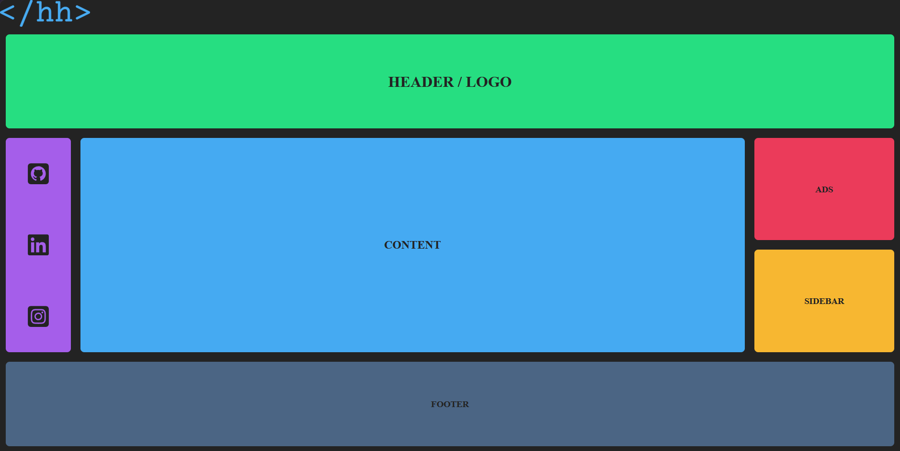
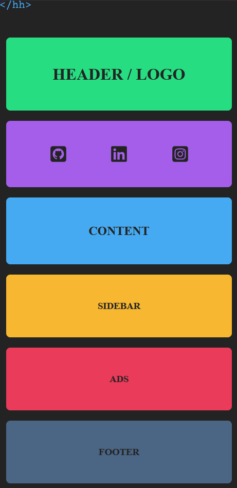

# Grid - Page Layout

Grid page layout using grid-template-areas created while learning web development through [W3Schools](https://www.w3schools.com/).

## Technologies

- HTML

- CSS

## Features

- Responsive design

- Full page layout

- Grid

## Screenshots

Index

<!-- 

Index Mobile

 -->
